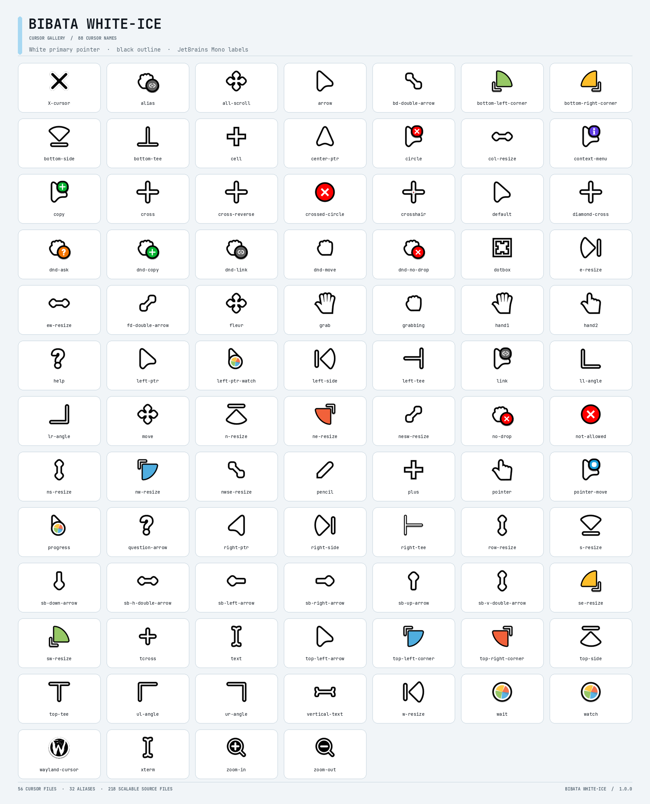

# Bibata White-Ice


## Cursor gallery

All 88 cursor names are shown below, including aliases. The sheet previews the compiled cursors; the SVG sources are in the theme folder.



A cursor theme based on Material Bibata, featuring the white pointer with a black outline shown in the project banner.

## Install

On Linux, clone or download this repository, then run:

```sh
./install.sh
```

The installer copies the theme to `~/.local/share/icons/Bibata-Material-White-Ice`. Select **Bibata-Material-White-Ice** in your desktop's cursor settings. On GNOME, you can also set it with:

```sh
gsettings set org.gnome.desktop.interface cursor-theme 'Bibata-Material-White-Ice'
```

The theme includes compiled Xcursor files in `cursors/` and scalable SVG sources with hotspot metadata in `cursors_scalable/`. The primary pointer is white with a black outline; some action and status cursors retain their semantic accent colors from Material Bibata.

## Palette

| Part | Color |
| --- | --- |
| Primary pointer body | White (`#ffffff`) |
| Primary pointer outline | Black (`#000000`) |

## Credits

This project re-colors and packages cursor assets based on [Material Bibata Cursor](https://github.com/SakibShahariar/material-bibata-cursor), which in turn derives from [Bibata Cursor](https://github.com/ful1e5/Bibata_Cursor) and [Bibata Cursor's source](https://github.com/rtgiskard/bibata_cursor). Their authors and contributors retain credit for the original work.

## License

The cursor artwork is distributed under **GNU GPL version 3 or later**. See [LICENSE](LICENSE). The license note in Material Bibata Cursor describes the compiled theme artifacts as derivatives of Bibata Cursor. This repository contains both the scalable source artwork and the compiled Xcursor files.
