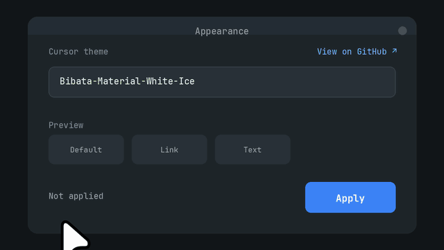
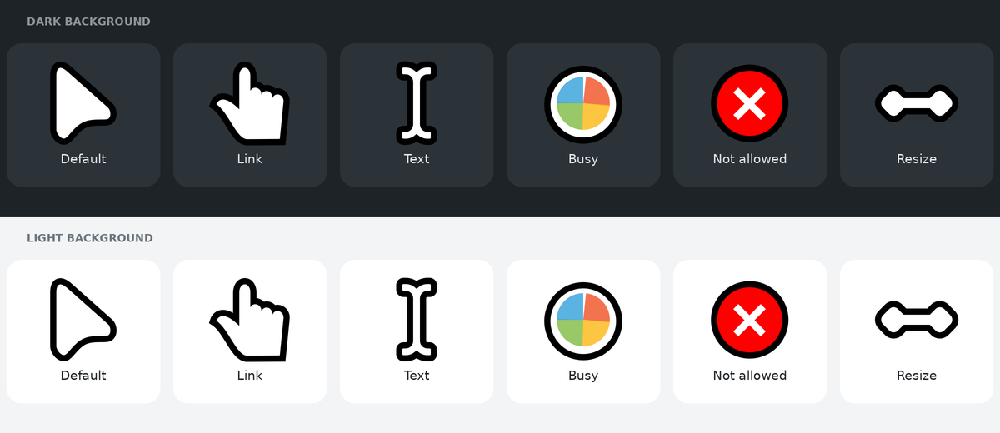

# Bibata White-Ice


Белая тема курсоров на основе Material Bibata с чёрным контуром для Linux. В комплекте скомпилированные файлы Xcursor и масштабируемые SVG-исходники для GNOME 51+.

[English](README.md) · **Русский**

[Особенности](#особенности) · [Превью](#превью) · [Установка](#установка) · [Применение темы](#применение-темы) · [Галерея](#галерея-курсоров) · [Авторы](#авторы-и-благодарности)

<p align="center">
  
</p>

## Особенности

- Белый указатель с чёрным контуром, хорошо виден и на тёмном, и на светлом фоне
- 88 имён курсоров, включая алиасы
- Скомпилированные файлы Xcursor в `cursors/` для любых окружений и приложений, которые используют Xcursor
- Масштабируемые SVG-исходники с метаданными hotspot в `cursors_scalable/` для GNOME 51+
- `install.sh` для установки в домашний каталог и `PKGBUILD` для Arch Linux

## Превью



Основной указатель белый с чёрным контуром. Часть курсоров действий и состояний сохраняет акцентные цвета из Material Bibata (например, красный курсор «запрещено»).

| Элемент                 | Цвет              |
|-------------------------|-------------------|
| Заливка указателя       | Белый (`#ffffff`) |
| Контур указателя        | Чёрный (`#000000`) |

## Установка

Скачайте готовый архив из [последнего релиза](https://github.com/NjDADE/bibata-white-ice/releases/latest) или клонируйте репозиторий.

### Установка для текущего пользователя

```bash
git clone https://github.com/NjDADE/bibata-white-ice.git
cd bibata-white-ice
./install.sh
```

Тема копируется в `~/.local/share/icons/Bibata-Material-White-Ice`.

### Установка для всех пользователей

```bash
sudo cp -r Bibata-Material-White-Ice /usr/share/icons/
```

### Arch Linux

Скачайте готовый пакет из [последнего релиза](https://github.com/NjDADE/bibata-white-ice/releases/latest) и установите через pacman:

```bash
sudo pacman -U ./bibata-white-ice-*-any.pkg.tar.zst
```

Можно также открыть скачанный файл в графическом установщике пакетов (Pamac, Octopi), если он у вас установлен.

Или соберите пакет сами. В репозитории есть `PKGBUILD`, он скачивает архив релиза и собирает пакет:

```bash
git clone https://github.com/NjDADE/bibata-white-ice.git
cd bibata-white-ice
makepkg -si
```

## Применение темы

Выберите **Bibata-Material-White-Ice** в настройках курсора вашего окружения или используйте команду:

| Окружение | Как |
|---|---|
| GNOME | `gsettings set org.gnome.desktop.interface cursor-theme 'Bibata-Material-White-Ice'` |
| KDE Plasma | Параметры системы → Внешний вид → Курсоры |
| XFCE | Параметры → Мышь и сенсорная панель → Тема |
| Hyprland | `hyprctl setcursor Bibata-Material-White-Ice 24` |
| Sway | `seat seat0 xcursor_theme Bibata-Material-White-Ice 24` |

### Flatpak-приложения

Если курсор не меняется в Flatpak-приложении, дайте Flatpak-приложениям доступ на чтение к пользовательскому каталогу иконок и перезапустите приложение:

```bash
flatpak override --user --filesystem=xdg-data/icons:ro
```

`xdg-data/icons` это псевдоним Flatpak для `~/.local/share/icons`. Отменить: `flatpak override --user --reset`.

## Удаление

```bash
rm -rf ~/.local/share/icons/Bibata-Material-White-Ice
```

Если ставили для всех пользователей, удалите `/usr/share/icons/Bibata-Material-White-Ice` через `sudo`. В Arch: `sudo pacman -R bibata-white-ice`.

## Входящие форматы

| Папка | Содержимое | Для чего |
|---|---|---|
| `cursors/` | Скомпилированные файлы Xcursor | Окружения и приложения, использующие Xcursor |
| `cursors_scalable/` | SVG-исходники с метаданными hotspot | GNOME 51 и новее |

Название темы: **Bibata-Material-White-Ice**.

## Галерея курсоров

Ниже показаны все 88 имён курсоров, включая алиасы. На листе превью скомпилированных курсоров, SVG-исходники лежат в папке темы.


## Авторы и благодарности

Оригинальный дизайн курсоров Bibata создал [Abdulkaiz Khatri](https://github.com/ful1e5/Bibata_Cursor). Проект основан на [Material Bibata Cursor](https://github.com/SakibShahariar/material-bibata-cursor) (Sakib Shahariar Shimanto) и [Bibata Cursor](https://github.com/rtgiskard/bibata_cursor) (rtgiskard). Bibata White-Ice перекрашивает и упаковывает эти ресурсы; авторские права на исходные работы остаются за их авторами.

## Лицензия

Графика курсоров распространяется под **GNU GPL версии 3 или новее**. См. [LICENSE](LICENSE). В заметке о лицензии Material Bibata Cursor скомпилированные файлы темы названы производными от Bibata Cursor. Этот репозиторий содержит и масштабируемые SVG-исходники, и скомпилированные файлы Xcursor.
